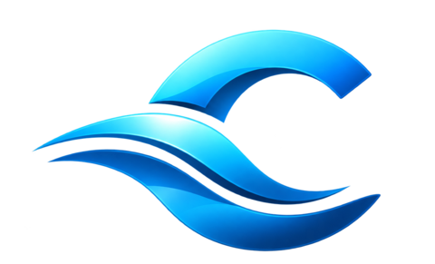
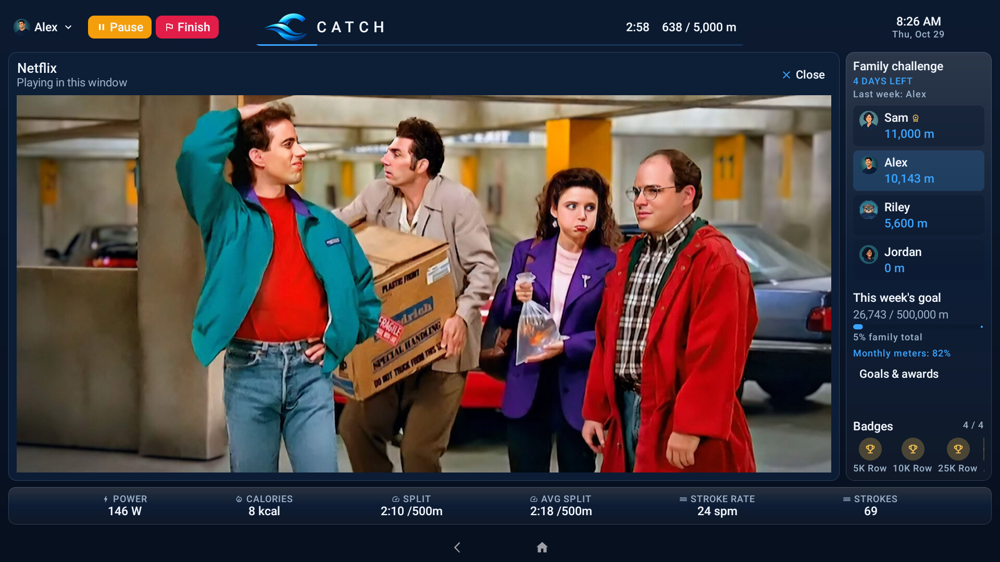
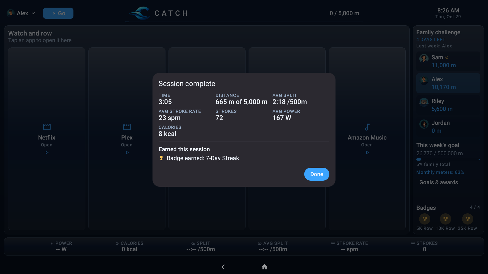
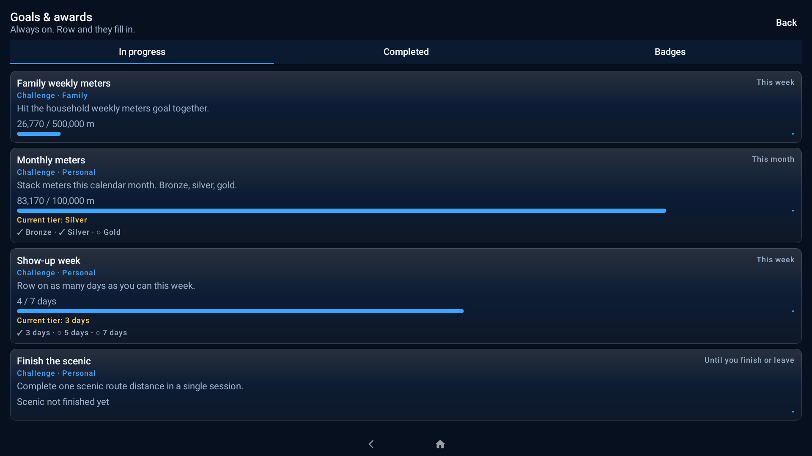
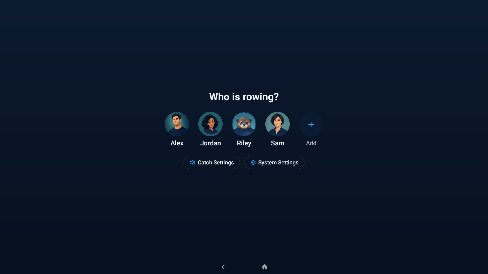
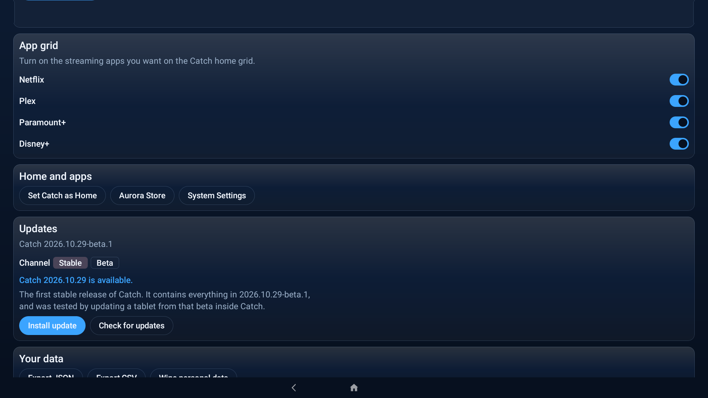

<p align="center">
  
</p>

<h3 align="center">Your Hydrow, your shows, your family.</h3>

<p align="center">
  An open-source home screen for the Hydrow rower. Row with live metrics while
  Netflix, Plex, or Disney+ plays right beside them, and turn every session into
  goals, challenges, and badges the whole household chases together.
</p>

<p align="center">
  <a href="LICENSE"></a>
  <a href="https://github.com/thegregstengel/catch/releases/latest"></a>
  <a href="https://github.com/thegregstengel/catch/actions/workflows/ci.yml"></a>
  
</p>

---

## The idea

A Hydrow is a great rower with a big screen attached, and that screen only
does one thing. When the membership lapses, or you would rather row through an
episode than a class, the screen has nothing for you.

Catch gives the screen back:

**Pick who is rowing. Tap Go. Watch whatever you like. Your meters count.**

Catch replaces the stock launcher on a rooted Hydrow tablet. It reads the
rower's brake directly, so power, split, stroke rate, and distance are live from
the first stroke, and it plays streaming apps inside its own frame, so the
numbers never leave the screen. Every meter lands on a family board, where
weekly goals, challenges, streaks, and badges keep everyone coming back.

<p align="center">
  
</p>

## What it looks like

Screens from the current build, captured on a Hydrow tablet with a demo family.

<table>
  <tr>
    <td width="50%"><br><sub><b>Session summary.</b> Time, distance, average split, stroke rate, strokes, power, and calories, plus every goal, challenge tier, and badge the row just earned.</sub></td>
    <td width="50%"><br><sub><b>Goals and awards.</b> Family weekly meters, monthly bronze, silver, and gold tiers, show-up weeks, and scenic routes. Always on: row and they fill in.</sub></td>
  </tr>
  <tr>
    <td width="50%"><br><sub><b>Who is rowing?</b> A profile for everyone in the house, with a photo or an illustrated avatar. Catch remembers each person's headphones and heart rate strap.</sub></td>
    <td width="50%"><br><sub><b>Updates.</b> Catch checks for new releases once a day and installs them from Settings in a few seconds, on a stable or beta channel.</sub></td>
  </tr>
</table>

## What it does today

- **Live rower metrics.** Power, calories, split, average split, stroke rate,
  strokes, elapsed time, and distance against your session goal, read straight
  from the Hydrow brake about 100 times a second. Set the resistance from Catch.
- **Watch while you row.** Netflix, Plex, Paramount+, and Disney+ open inside
  the Catch frame with touch and Back working, so the metrics and the family
  board stay on screen.
- **No Google required.** The Hydrow tablet has no Google Play Store or Google
  Play services, and Catch doesn't need them. [Aurora Store](https://auroraoss.com/)
  installs and updates the streaming apps from the Play catalog with an
  anonymous account, so you never sign in to Google on the rower.
- **Family profiles.** Everyone picks themselves on the "Who is rowing?" screen.
  Each profile keeps its own history, badges, and Bluetooth devices.
- **Heart rate.** Pair a Bluetooth heart rate strap once and Catch connects it
  whenever that person rows, with live heart rate and zone.
- **Goals, challenges, and badges.** A weekly family leaderboard with last
  week's winner, family weekly and monthly goals, tiered challenges, and
  distance and streak badges.
- **Session summary.** Finish a row and see the whole session, plus everything
  it earned, at a glance.
- **Your data stays home.** Everything lives on the tablet. Export workouts as
  JSON or CSV, or wipe personal data, from Catch Settings.
- **Updates in place.** Catch updates itself from GitHub Releases, checks every
  download's SHA-256, and keeps all of your history.

## Get it

Catch runs on a **rooted** Hydrow rower tablet. It's tested on a Hydrow Origin, whose
Android 10 tablet reports model `foenix_h` (MediaTek MT8167); the install guide
shows how to check yours. Rooting needs a computer, about an hour, and some comfort with the
Android command line.

1. Follow [Install Catch](docs/install.md) to root the tablet with Magisk.
1. Download `catch-magisk-<version>.zip` from the
   [latest release](https://github.com/thegregstengel/catch/releases/latest)
   and install it with Magisk.
1. Reboot. Catch opens as the Home screen and walks you through setup.

After that, Catch updates itself. See [Updates and releases](docs/updates.md).

## How it works

```text
            Hydrow brake ──serial──▶ ┌──────────────────────┐ ◀── Bluetooth heart rate
                                     │        Catch         │
                                     │  metrics, profiles,  │
     Streaming app ◀─secure display─ │  goals, badges       │ ◀── GitHub Releases
     (Netflix, Plex, ...)            └──────────────────────┘
                                       privileged Home app
                                       (Magisk module)
```

- **Catch is the Home app.** A Magisk module installs it as a privileged system
  app and turns off the stock Hydrow launcher, including its remote commands,
  updater, and logging.
- **The rower is read directly.** Catch speaks the brake controller's serial
  protocol itself. No cloud and no membership are involved.
- **Streaming apps play in a secure virtual display** owned by a small system
  process that ships inside the Catch APK. That is what lets copy-protected
  video play inside Catch's frame.
- **Updates are signed and verified.** Releases are built and signed by GitHub
  Actions, and tablets only accept updates signed with the same key.

The details are in [How Catch works](docs/how-it-works.md).

## Documentation

- [Install Catch](docs/install.md)
- [How Catch works](docs/how-it-works.md)
- [Updates and releases](docs/updates.md)
- [Develop Catch](docs/development.md)
- [Changelog](CHANGELOG.md)
- [Security policy](SECURITY.md)

## Help build Catch

Issues and pull requests are welcome, and questions about installing or setting
up Catch go in [Discussions](https://github.com/thegregstengel/catch/discussions).
The most useful things right now:

1. **Tell us whether Catch works on your Hydrow.** A
   [hardware report](https://github.com/thegregstengel/catch/issues/new?template=hardware_report.yml)
   shows which rowers the install guide fits, even if you only check your
   tablet's details.
1. **Report what breaks.** A
   [bug report](https://github.com/thegregstengel/catch/issues/new?template=bug_report.yml)
   asks for everything needed to fix it.
1. **Try other streaming apps in the pane** and file a
   [streaming app report](https://github.com/thegregstengel/catch/issues/new?template=app_report.yml).
1. **Send a pull request** for a bug you can reproduce or a small, well-scoped
   feature. For anything larger, open an issue first so we can agree on the
   shape.

[CONTRIBUTING.md](CONTRIBUTING.md) has the ground rules, and
[Develop Catch](docs/development.md) has the toolchain.

## License

MIT. See [LICENSE](LICENSE).

Hydrow is a trademark of Hydrow, Inc. Catch is an independent project and is
not affiliated with, endorsed by, or supported by Hydrow. Rooting your rower is
at your own risk. Netflix, Plex, Paramount+, and Disney+ are
trademarks of their respective owners.
